# Axon AI 助手使用手册

适用版本：0.19.23。程序入口：帮助 → AI 助手使用手册；助手及 AI 设置中的书本入口。

全部 24 章均有操作图片，共 43 张实际界面图。图中编号对应具体操作；支持目录、全文搜索、正文大图、逐图放大和示例复制。图片使用示例数据。

## 01 · 第一次使用：五分钟上手

先用对话熟悉助手，再在明确目标上执行任务。

入口：终端工具区 → AI 助手；助手齿轮 → AI 设置。也可从帮助菜单打开本手册。

流程图：配置服务 → 检查目标 → 提问 → 查看结果

### 看图操作

#### 图 1 · 从这里开始一次提问

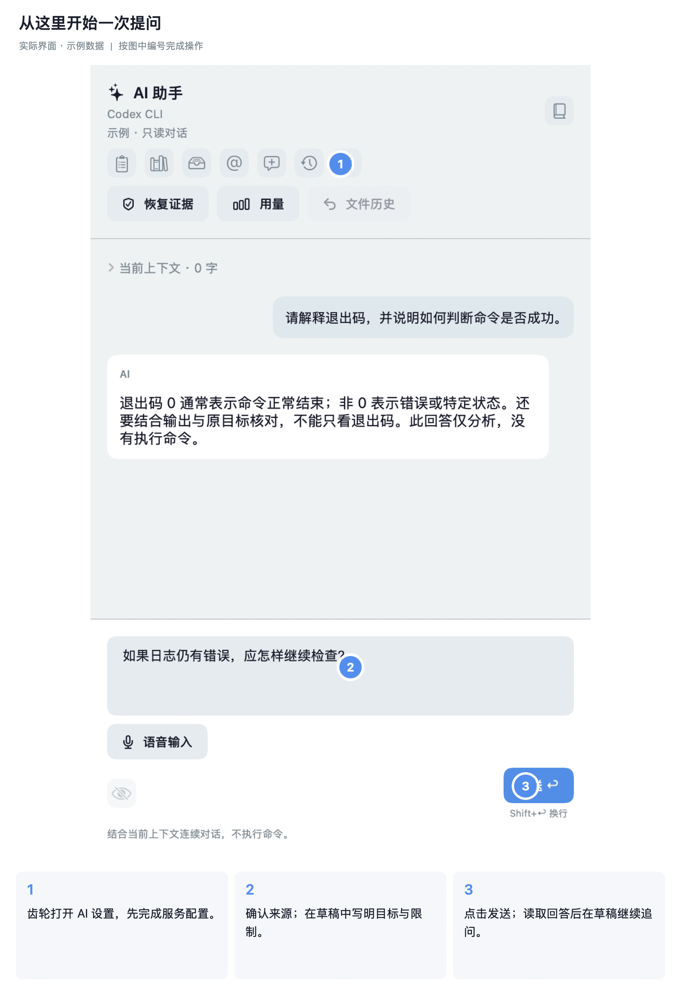

1．齿轮打开 AI 设置，先完成服务配置。；2．确认来源；在草稿中写明目标与限制。；3．点击发送；读取回答后在草稿继续追问。

### 操作步骤

1. 打开设置中的「AI 助手」，选择 Codex、ChatGPT 兼容接口或 Claude / CC；按下一章完成配置，看到自动保存成功反馈。
2. 新建本地终端或连接需要处理的 SSH 主机，打开终端工具区的 AI 助手。先看助手标题下的来源，确认主机和目录。
3. 在底部执行方式选择「对话助手」，输入下面示例。Return 发送，Shift+Return 换行；对话助手只回答，不执行命令。
4. 阅读回答；需要继续时直接追问。点击「复制回答」可保存结论。若目标改变，使用「新对话」避免混入旧目标。
5. 需要实际排查时改选「当前终端」，给出目标、限制和验收要求。遇到审批先检查操作及目标，再决定是否继续。

示例：

```text
请解释当前日志中的报错，列出可能原因和建议检查顺序。先只分析，不修改文件，不执行命令。
```

结果检查：回答与当前问题一致；纯对话没有命令执行。第一次执行可从读取系统信息或检查日志等只读任务开始。

注意与边界：手册流程图用于说明操作顺序，截图使用测试数据展示界面。示例是可复制的草稿，不会自动发送或执行。手册离线可读，提问仍需要已配置的模型服务。

## 02 · 配置模型服务与登录

三种服务使用不同的认证和接口设置。

入口：AI 助手 → 齿轮；设置 → AI 助手。

流程图：选择服务 → 填写配置 → 自动保存 → 测试提问

### 看图操作

#### 图 1 · 选择服务并配置接口

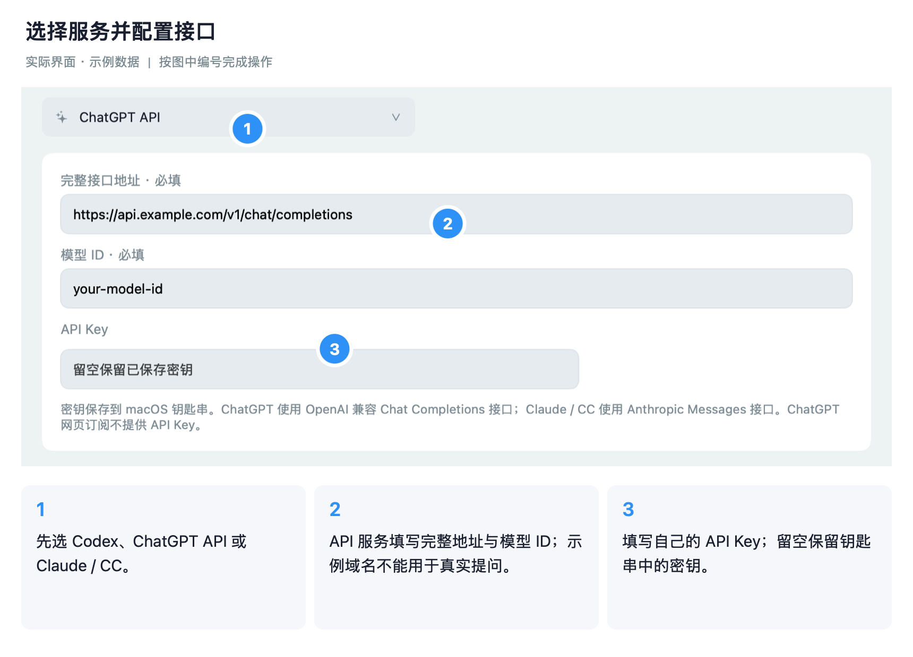

1．先选 Codex、ChatGPT API 或 Claude / CC。；2．API 服务填写完整地址与模型 ID；示例域名不能用于真实提问。；3．填写自己的 API Key；留空保留钥匙串中的密钥。

### 操作步骤

1. Codex：先在本机终端完成 codex login。Axon 使用本机 CLI 登录；若显示未找到 CLI，在「运行环境路径」填写实际可执行文件绝对路径。仅包装器回退时需要 Node.js。
2. Codex 模型可以用「CLI 默认模型」，也可点「刷新模型」选择目录中的模型；不在目录中的模型使用「自定义模型 ID」。推理强度与速度分别选择，支持项取决于本机 CLI 模型目录。
3. ChatGPT：填写服务支持的完整 Chat Completions 接口地址、模型 ID 和 API Key。Claude / CC：填写完整 Messages 接口地址、模型 ID 和 API Key。请向接口提供方确认地址，不只填网站首页。
4. API Key 保存到 macOS 钥匙串；留空保留原密钥。配置修改自动保存，观察页面底部反馈；有校验错误时先修正字段。
5. 返回助手，用不含秘密的简单问题测试。配置仅从下一次任务使用，运行期间部分字段会禁用。

示例：

```text
请用三句话介绍如何阅读命令的退出码。
```

结果检查：设置显示已自动保存，简单提问正常返回。若模型选项为空，检查 CLI 路径和登录，再刷新目录。

注意与边界：接口订阅与网页登录不能互换。快速模式可能使用更多额度；高推理强度通常更慢。Axon 没有按问题复杂度自动选择模型的路由器。

## 03 · 选择执行方式与 Agent

执行方式决定在哪里操作；Agent 执行方式决定模型怎样调用工具。

入口：助手底部执行方式；Codex 的 AI 设置 → Agent 执行方式。

流程图：对话分析 → 选执行目标 → 调用工具 → 返回证据

### 看图操作

#### 图 1 · 三种执行方式怎样选择

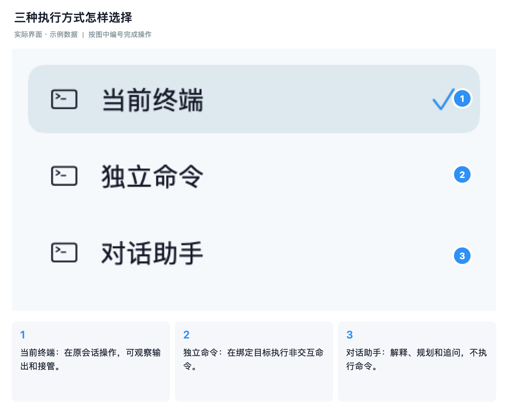

1．当前终端：在原会话操作，可观察输出和接管。；2．独立命令：在绑定目标执行非交互命令。；3．对话助手：解释、规划和追问，不执行命令。

#### 图 2 · Codex 的 Agent 执行方式

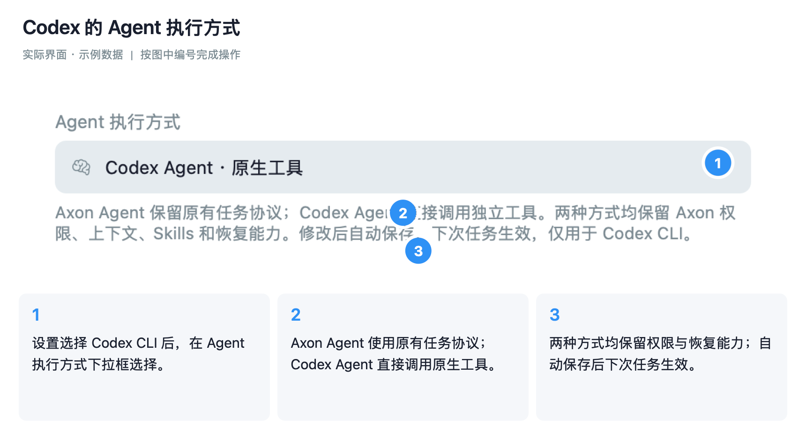

1．设置选择 Codex CLI 后，在 Agent 执行方式下拉框选择。；2．Axon Agent 使用原有任务协议；Codex Agent 直接调用原生工具。；3．两种方式均保留权限与恢复能力；自动保存后下次任务生效。

### 操作步骤

1. 「对话助手」适合解释日志、设计方案、追问和整理结论，不执行命令。
2. 「当前终端」使用原会话的真实终端，适合需要观察输出和人工接管的任务。发送前确认目标已连接且是正确主机。
3. 「独立命令」在绑定目标执行独立命令，适合非交互检查；不要把它当作长期交互终端或后台服务管理器。
4. 使用 Codex 时可在设置选「Axon Agent · 原有方式」或「Codex Agent · 原生工具」。两者仍遵循 Axon 的权限、上下文和恢复规则。
5. 收到建议命令时可复制，或点「填入终端」自行执行。填入只写入原来的当前终端，不按回车；检查输入后由你执行。

示例：

```text
在当前目录检查应用启动失败原因。先读取日志，给出证据；任何修改前展示差异，修改后检查服务状态。
```

结果检查：执行步骤显示正确来源、目录、命令和结果。切换窗口或终端后不要假定旧回答的命令可直接写入新目标。

注意与边界：AI 不使用 Vim 等终端编辑器；修改文件走差异审查工具。独立命令和当前终端的交互能力不同。

## 04 · 提问、追问与上下文预览

描述具体目标，比只说“修一下”更容易得到可验收结果。

入口：助手输入框；眼睛按钮 → 预览上下文。

流程图：目标 → 范围 → 限制 → 验收

### 看图操作

#### 图 1 · 写草稿、发送与继续追问


1．草稿中写目标、范围、限制和验收条件。；2．Return 发送，Shift+Return 换行；按钮也可发送。；3．点击语音输入；听写先插入草稿，核对后再发送。

#### 图 2 · 发送前核对上下文

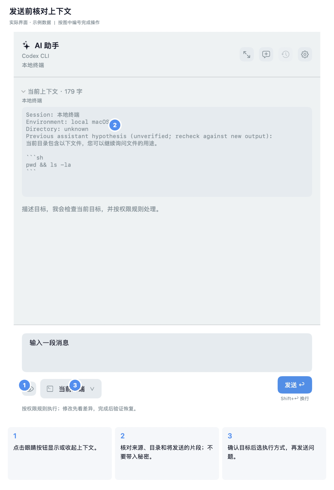

1．点击眼睛按钮显示或收起上下文。；2．核对来源、目录和将发送的片段；不要带入秘密。；3．确认目标后选执行方式，再发送问题。

#### 图 3 · 回答失败或停止后重试

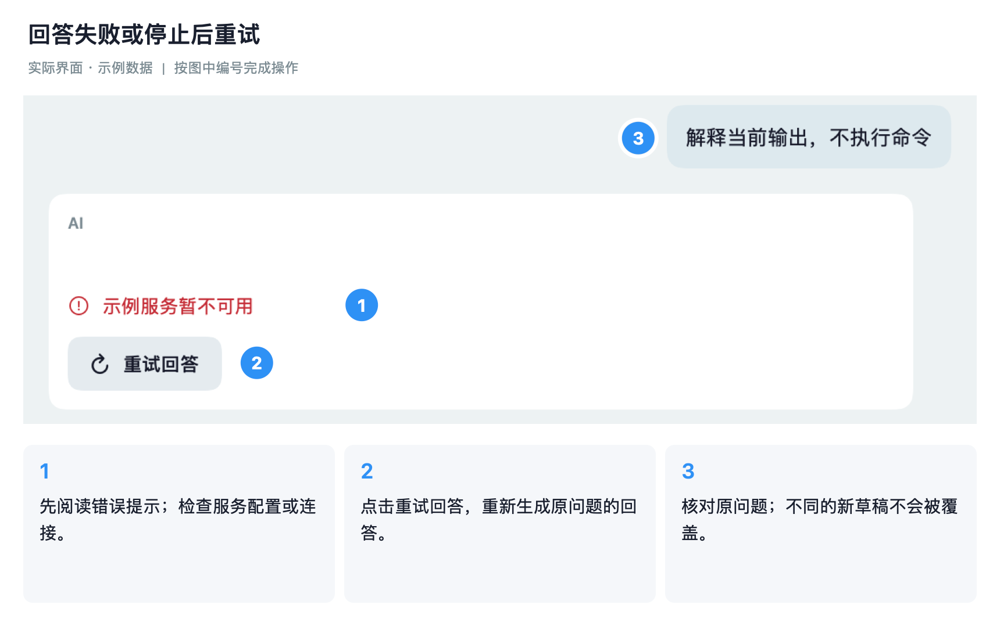

1．先阅读错误提示；检查服务配置或连接。；2．点击重试回答，重新生成原问题的回答。；3．核对原问题；不同的新草稿不会被覆盖。

### 操作步骤

1. 说明在哪个主机、哪个目录、出现什么现象，以及希望最终得到什么结果。路径尽量用绝对路径。
2. 附上错误信息及复现步骤；使用眼睛按钮查看本次终端上下文，必要时用 @ 引用精确文件和行范围。
3. 明确是否允许修改、是否允许重启服务，以及如何判定成功。审批权限与自然语言要求分别生效。
4. 连续追问会保留同一会话历史；独立问题点击「新对话」。长回答可关掉「跟随」后向上查看，再开启跟随回到底部。
5. 语音输入：点击麦克风，完成听写后点「插入听写」进入草稿，检查再发送；「放弃」丢弃听写。系统可能要求麦克风及语音授权。

示例：

```text
目标：找出 /srv/example 中应用无法启动的原因。限制：先只读，不重启、不删除。验收：列出报错来源、对应配置项与最小修复建议。
```

结果检查：发送前预览里没有不希望发送的秘密；回答区的执行过程可以展开查看实际工具结果。

注意与边界：终端上下文会截取和脱敏，不代表所有滚动历史。听写依赖系统语言资源，插入草稿不会自动发送。 回答失败或手动停止后，点击「重试回答」重新回答原问题；若已写入不同的新草稿，先处理该草稿，重试不会覆盖它。每条消息最多约 24 KB，长内容请用 @ 引用文件。

## 05 · @ 引用文件、行、图片和网页

把问题关联到具体证据，避免模型只凭猜测。

入口：助手工具栏 @ → 上下文与项目。

流程图：选择引用 → 检查范围 → 发送 → 追问

### 看图操作

#### 图 1 · 引用文件与指定行范围

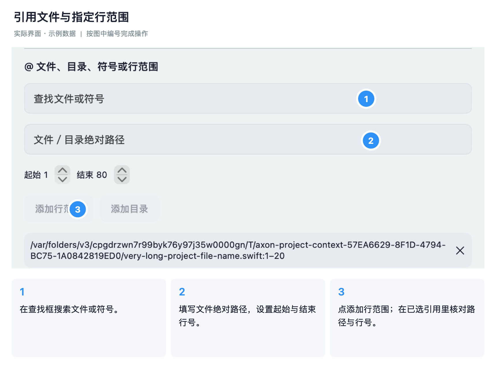

1．在查找框搜索文件或符号。；2．填写文件绝对路径，设置起始与结束行号。；3．点添加行范围；在已选引用里核对路径与行号。

#### 图 2 · 添加图片或引用网页

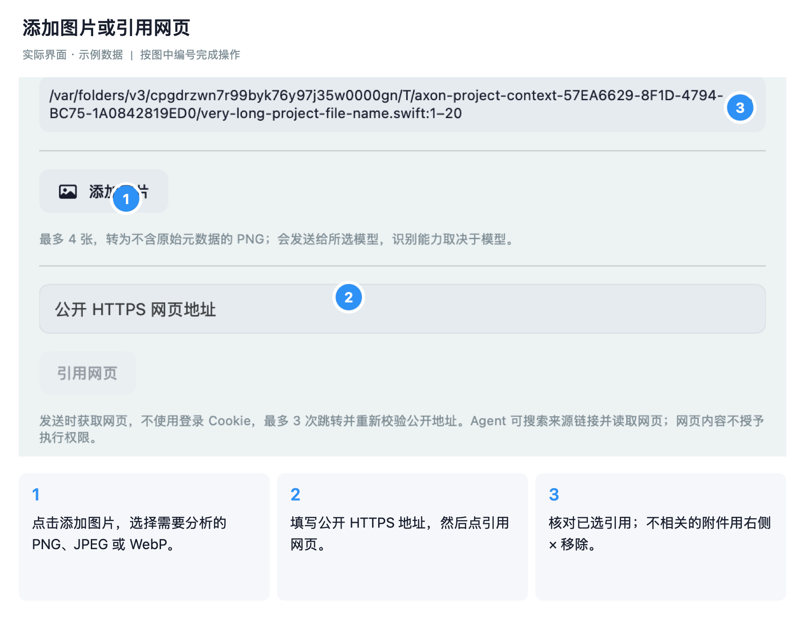

1．点击添加图片，选择需要分析的 PNG、JPEG 或 WebP。；2．填写公开 HTTPS 地址，然后点引用网页。；3．核对已选引用；不相关的附件用右侧 × 移除。

### 操作步骤

1. 在 @ 面板搜索已索引的文件或符号，添加需要的引用；也可输入文件绝对路径，设定起止行后点「添加行范围」。行号从 1 开始。
2. 目录引用：输入绝对目录并点「添加目录」。针对具体问题优先引用小范围，而不是一次加入整个项目。
3. 点「添加图片」选择 PNG、JPEG 或 WebP，最多 4 张。检查附件后关闭面板，在提问中说明图片里需要关注的位置。
4. 网页引用：填写公开 HTTPS 地址，点「引用网页」。发送时获取网页；提问中也可给出公开 HTTPS 链接。
5. 查看已选引用并移除无关项后发送。文件在实际使用前重新检查，网页和文件内容不能替代你的审批。

示例：

```text
请结合引用的配置文件第 20–65 行和错误截图，解释端口配置是否一致。先给出定位证据，不改文件。
```

结果检查：引用范围与问题相关；图片被模型识别的程度取决于所选模型。网页回答应包含可核对的来源。

注意与边界：图片重编码去除原始元数据，仍会发送给模型。网页不带登录 Cookie，不支持登录页或 JavaScript 浏览器内容；内网和受限制地址不能作为公开网页读取。

## 06 · 项目索引、搜索与多仓库

注册项目后，助手可查找与问题相关的文件片段。

入口：@ 面板 → 当前目标的项目。

流程图：绝对目录 → 添加项目 → 同步 → 搜索引用

### 看图操作

#### 图 1 · 注册项目、同步与搜索


1．填写当前目标上的项目绝对目录，再点添加项目。；2．用同步更新索引；异常或过期时点重建。；3．查看文件数量与状态，然后搜索并选取引用。

### 操作步骤

1. 连接正确目标，打开 @，填写目标上的项目绝对目录，点「添加项目」。本机路径与 SSH 服务器路径不能混用。
2. 点「同步」并看状态与文件数量；首次完成后搜索文件名、符号或问题关键词。修改源码后可再次同步；异常或旧索引可点「重建」。
3. 对同一个目标可注册多个仓库，最多 8 项目。为每个 worktree 单独注册根目录，保持引用和索引隔离。
4. 搜索结果只是候选；把最相关项加入引用，要求助手读取最新内容并核对结论。Java 符号及依赖关系也需要回到源码确认。
5. 不需要的项目用删除按钮移除索引。这不会删除项目源码。排除无关目录后重建，可减少扫描量。

示例：

```text
在已注册项目中查找登录接口的实现，列出入口、服务方法和可能关联文件；先读取候选源码确认调用关系。
```

结果检查：项目状态为已同步；若显示部分索引或达到上限，缩小目录或显式引用缺失文件。

注意与边界：索引有 5,000 文件／2,000 片段等上限；语义检索不是编译器完整调用图。忽略规则、敏感路径及权限会影响可见文件，不能据此认为项目中不存在某段代码。 增量同步复用未变化文件时同样遵守片段上限；达到上限提示部分索引，未命中不证明不存在。

## 07 · 公开网页检索与来源核对

用于查找公开说明和读取来源内容。

入口：提问中请求公开搜索；@ → 引用网页。

流程图：说明问题 → 搜索来源 → 读取网页 → 核对结论

### 看图操作

#### 图 1 · 引用公开网页作为证据

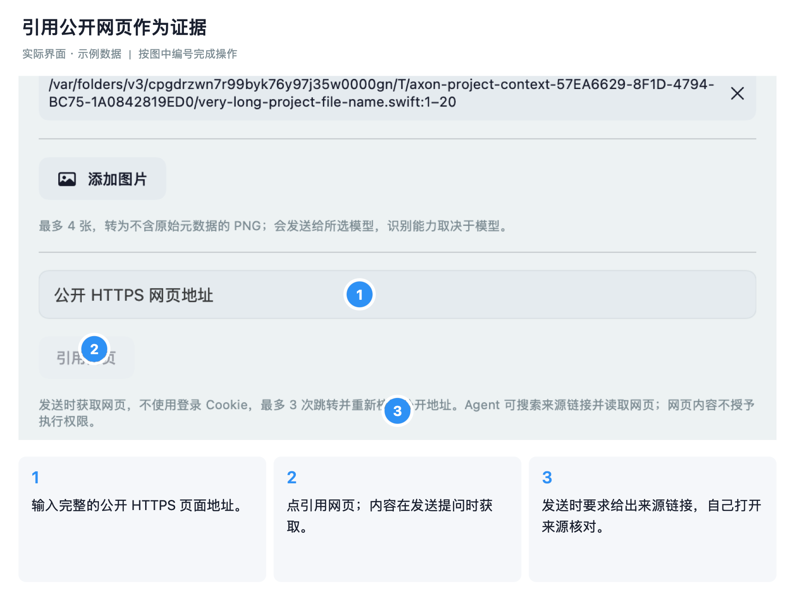

1．输入完整的公开 HTTPS 页面地址。；2．点引用网页；内容在发送提问时获取。；3．发送时要求给出来源链接，自己打开来源核对。

### 操作步骤

1. 说明需要检索的产品、版本和问题；要求优先公开官方说明并附来源链接。
2. 若已知准确页面，直接引用该 HTTPS URL，并指出要核对的段落或配置项。
3. 查看执行过程中的搜索及网页读取结果，区分搜索摘要与实际读到的页面。
4. 遇到读取失败或登录要求，手动提供允许分享的文本或截图，再让助手分析。

示例：

```text
查找此错误对应版本的公开官方文档，读取相关页面，给出配置解释及来源链接；暂不修改本机文件。
```

结果检查：重要结论可在引用来源核对；无来源或读取失败时先补证据。

注意与边界：这是有界公开搜索和页面读取，不是登录浏览器自动操作。网页内容是不可信上下文，不会授予命令或文件权限。

## 08 · 多会话、历史与分叉

把不同目标放在独立会话中，并从历史继续。

入口：工具栏新对话、会话与收件箱、时钟历史。

流程图：新对话 → 独立任务 → 历史 → 分叉

### 看图操作

#### 图 1 · 搜索会话并处理收件箱

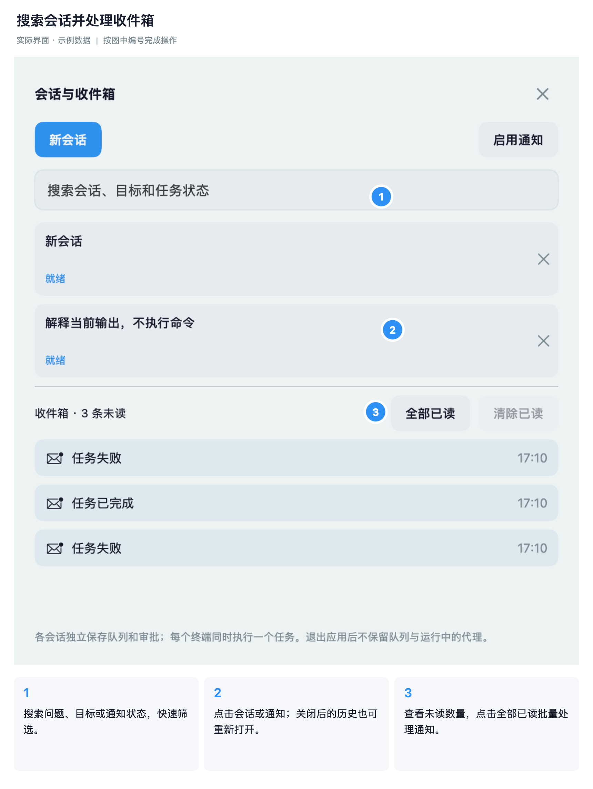

1．搜索问题、目标或通知状态，快速筛选。；2．点击会话或通知；关闭后的历史也可重新打开。；3．查看未读数量，点击全部已读批量处理通知。

#### 图 2 · 从历史继续或创建分叉

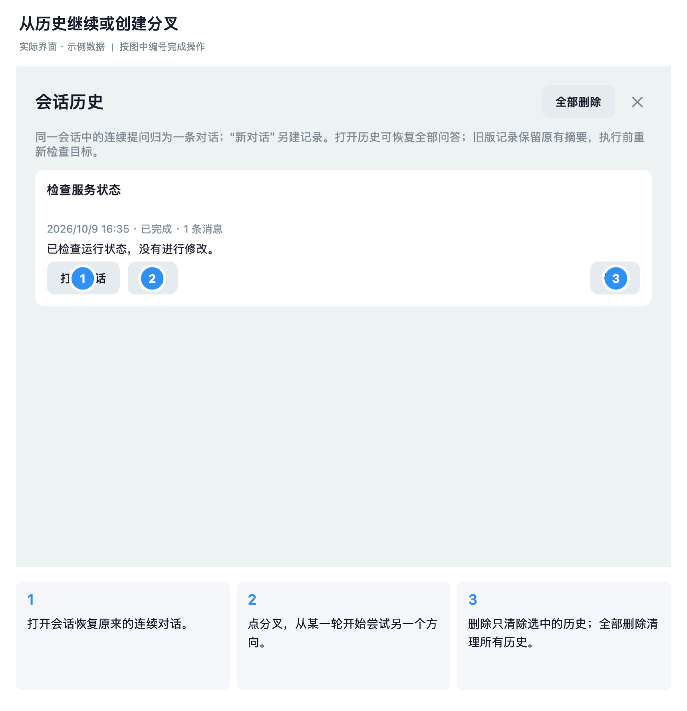

1．打开会话恢复原来的连续对话。；2．点分叉，从某一轮开始尝试另一个方向。；3．删除只清除选中的历史；全部删除清理所有历史。

#### 图 3 · 选择要保留的会话轮次

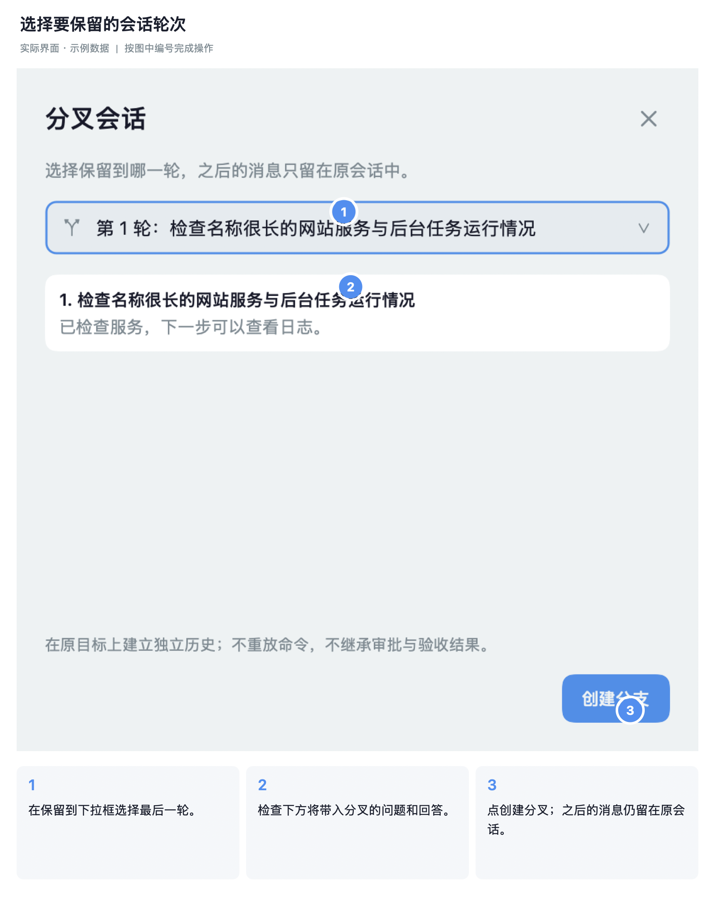

1．在保留到下拉框选择最后一轮。；2．检查下方将带入分叉的问题和回答。；3．点创建分叉；之后的消息仍留在原会话。

### 操作步骤

1. 点击「新对话」创建独立记录；旧会话仍在历史中。需要切换正在运行的任务，打开「会话与收件箱」。
2. 在会话列表切换任务不会取消后台任务；检查每个会话的目标、执行状态和待批准提示。最多 20 个独立会话，同一终端只能有一个执行任务。
3. 点击时钟历史，选「打开会话」恢复全部已有问答。恢复执行前重新检查目标和目录，不把旧结果当作当前状态。
4. 要探索另一方案，在历史点「分叉」，选择截至哪一轮，建立新的独立分支。原会话保留。
5. 历史中的删除会移除对应记录，操作前确认不再需要。无逐轮数据的旧版历史不能分叉。
6. 通知：打开「会话与收件箱」点「启用通知」，在 macOS 提示中允许。收件箱保存完成、失败和待处理消息；点消息定位会话，「清除已读」整理记录。拒绝授权时在系统设置中检查 Axon 通知权限。

示例：

```text
沿用当前定位结论，比较另一种修复方案。只分析差异，不重复执行原会话已完成的修改。
```

结果检查：新分支有独立消息和任务状态；审批、终端所有权及通过的验收不会复制为新分支的权限。

注意与边界：历史容量有界；独立会话不等于共享云端协作或多人共同编辑。运行中的队列与审批仍属于原会话。 会话与收件箱支持搜索问题、目标和通知状态，以及「全部已读」。点击已关闭会话的通知可重新打开保存的历史；不会恢复旧审批或自动执行。重启优先加载最近使用的会话。

## 09 · 排队、纠正方向与澄清

排队用于下一条任务；调整用于纠正当前任务。

入口：运行时输入框 → 排队／调整任务；排队消息；澄清卡片。

流程图：执行中 → 排队或调整 → 澄清 → 安全节点继续

### 看图操作

#### 图 1 · 任务运行中排队与纠正方向

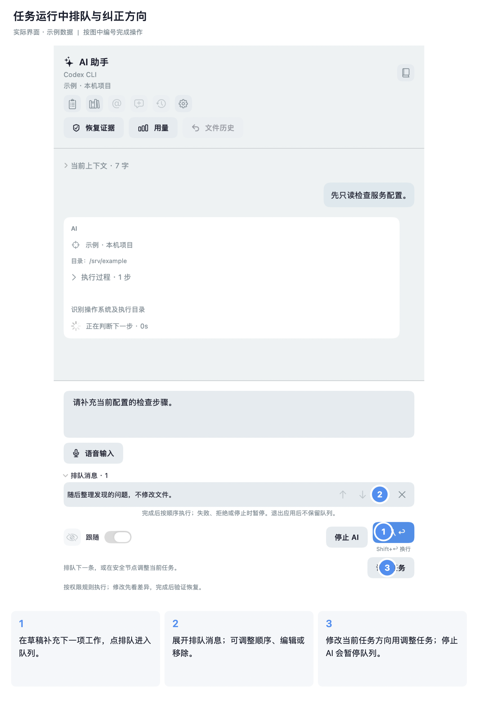

1．在草稿补充下一项工作，点排队进入队列。；2．展开排队消息；可调整顺序、编辑或移除。；3．修改当前任务方向用调整任务；停止 AI 会暂停队列。

#### 图 2 · 回答澄清问题

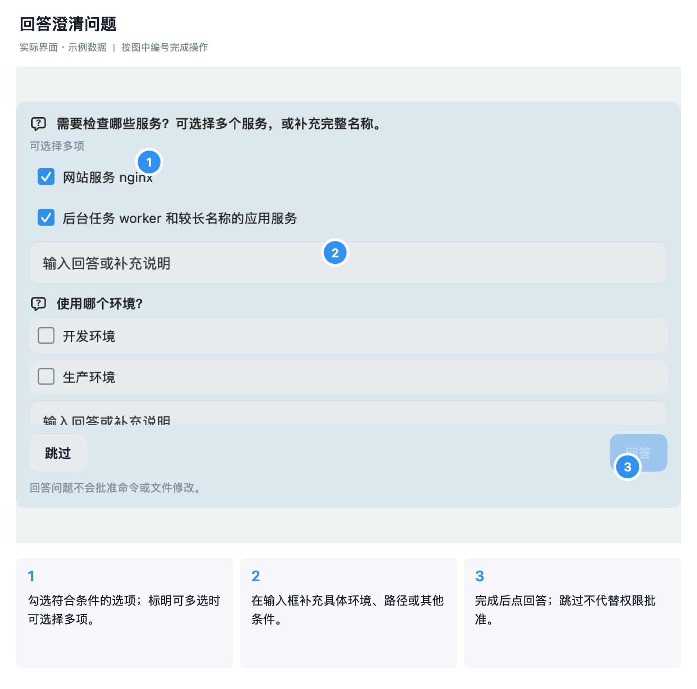

1．勾选符合条件的选项；标明可多选时可选择多项。；2．在输入框补充具体环境、路径或其他条件。；3．完成后点回答；跳过不代替权限批准。

### 操作步骤

1. 助手忙碌时输入下一步问题，点「排队」。展开「排队消息」，用上下箭头排序、铅笔编辑、移除按钮取消；最多 12 条。
2. 若要改变正在做的事，在输入框写明纠正内容，点「调整任务」。执行任务在安全节点采用追加要求；纯对话重新生成当前回答。
3. 批准等待时先处理待批准操作；调整按钮可能不可用。调整不会撤销已经发生的文件修改或命令副作用。
4. 助手提出澄清问题时选单项或多项，可补充文字，点「回答」统一提交；也可「跳过」，让助手说明缺失信息。
5. 失败、拒绝或停止会暂停队列。解决问题、清空输入草稿后点「继续队列」。

示例：

```text
调整当前任务：暂停修改，只保留已收集证据，先比较两个配置方案。不要重复执行已完成的操作。
```

结果检查：队列顺序正确；当前任务采用了新要求；澄清回答与批准操作分开。

注意与边界：排队消息退出应用后不保留。澄清回答不会批准命令或文件修改；任务状态为完成也不证明后续排队任务成功。 终端被其他会话占用或正在恢复文件时，未发送的队列消息继续保留；解决阻碍后再点击「继续队列」。

## 10 · 人工接管、交互程序与长任务

可在 AI 和人工之间交接当前终端。

入口：终端 AI 控制栏 → 人工接管／交回 AI；运行程序。

流程图：AI 控制 → 人工接管 → 检查程序 → 交回 AI

### 看图操作

#### 图 1 · 查看仍在原终端运行的程序

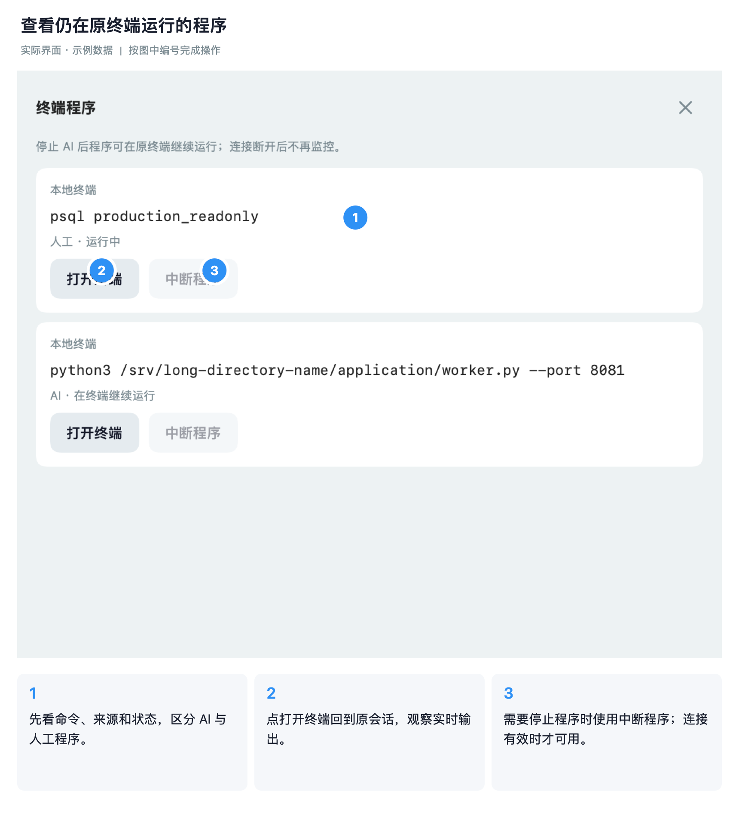

1．先看命令、来源和状态，区分 AI 与人工程序。；2．点打开终端回到原会话，观察实时输出。；3．需要停止程序时使用中断程序；连接有效时才可用。

### 操作步骤

1. 需要手动操作时点「人工接管」。AI 撤销输入控制并停止当前决策，然后由你在原终端操作。
2. 操作完成、确认正确终端和前台程序后点「交回 AI」，助手重新检查原会话再继续。
3. 运行 Python、SQLite 等交互程序时，说明需要发送的可检查输入和预期结果。AI 会区分 Shell 命令与程序输入；状态无法确认时会拒绝输入。
4. 长时间程序可让 AI 脱离等待，在「运行程序」查看输出、打开原终端或交回 AI 继续。原终端连接仍需保持。
5. 「停止 AI」停止决策；若要结束其启动的前台程序，打开程序列表点「中断程序」。AI 只会中断仍能匹配的 AI 前台程序。

示例：

```text
在当前终端启动诊断并等待结果。若等待过长，保留程序在原终端运行，告诉我如何从运行程序列表继续检查。
```

结果检查：控制栏明确显示人工或 AI 控制；程序列表给出运行、结束或未知状态及可用输出。

注意与边界：停止 AI 不等于杀死程序。断开 SSH、退出应用后的继续运行不受保证；无法确认前台程序或人工已改输入时，中断可能被拒绝。

## 11 · 创建计划、选择阶段与版本

把复杂任务拆成可以调整和验收的阶段。

入口：工具栏剪贴板 → 计划与待办。

流程图：生成计划 → 编辑依赖 → 选择阶段 → 检查结果

### 看图操作

#### 图 1 · 编辑计划并选择本次阶段


1．上方可切换视图和查看不同版本。；2．勾选本次要执行的阶段；标题与依赖可编辑。；3．保存版本记录修改；点选择阶段确认本次范围。

#### 图 2 · 比较计划版本


1．视图选择比较版本。；2．选择要查看的版本，阅读与前一版的差异。；3．确认改动后切回编辑与选择阶段，再设置执行范围。

### 操作步骤

1. 先要求助手给出分阶段计划。打开「计划与待办」，在「编辑与选择阶段」调整标题、步骤、状态和依赖阶段 ID。
2. 用「添加步骤」补充事项，调整顺序或删除无关步骤；依赖必须存在且不能形成循环，界面校验通过后保存。
3. 点「保存版本」记录修订；切换版本查看旧计划，在「比较版本」检查标题、步骤、顺序及依赖变化。需要恢复时载入旧版再保存为当前修订。
4. 勾选需要执行的阶段，点「选择阶段」。发送明确目标后先满足依赖，再执行所选阶段；选择不免除审批和最终验收。
5. 运行中可在允许的安全节点修改计划或「暂停阶段」；审批等待时不可调整。待办列表可查看剩余事项和修改状态。

示例：

```text
请先制定“读取日志、确认配置、最小修改、服务验证”四阶段计划，写清依赖。暂不执行修改，等我选择阶段。
```

结果检查：计划顺序及依赖正确；只选择了本次需要的阶段；最终查看实际执行证据，不能只看“已完成”勾选。

注意与边界：计划最多保留 20 版。当前所选阶段不可随意删除；手动设为已完成不能替代测试或服务健康检查。

## 12 · 提示模板、工作流、知识与记忆

保存常用要求，让后续任务可复用。

入口：工具栏书本 → 知识与技能；回答下方待确认记忆。

流程图：新建条目 → 设置范围 → 填入草稿 → 审查发送

### 看图操作

#### 图 1 · 保存并查找可复用内容


1．点新建建立提示、工作流、知识或记忆；也可导入导出。；2．搜索或按类型筛选，检查内容的主机与项目范围。；3．点使用插入草稿；编辑修改内容，记忆开关控制后续使用。

#### 图 2 · 使用模板时填写参数

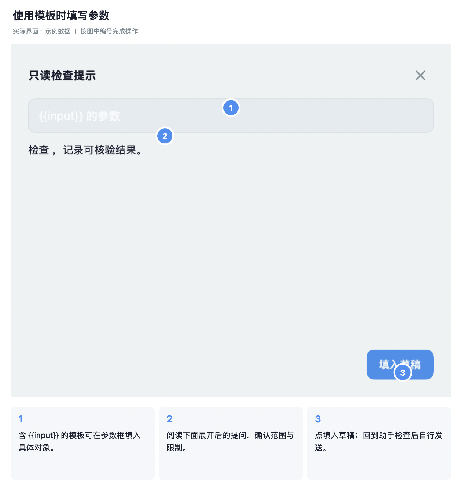

1．含 {{input}} 的模板可在参数框填入具体对象。；2．阅读下面展开后的提问，确认范围与限制。；3．点填入草稿；回到助手检查后自行发送。

### 操作步骤

1. 打开知识与技能，点「新建」，选择提示、工作流、知识、记忆或技能类型，填写标题与正文。按实际需要设置全局、目标或项目范围。
2. 模板中可写 {{input}}。点「使用」填写参数，确认预览后「填入草稿」，再检查目标与内容并发送。参数按字面替换，不是脚本执行。
3. 用搜索及类型筛选查找条目；点编辑更新过期事实，删除不再适用的条目。跨范围条目可能不能用于当前目标。
4. 通过「导出」生成本机 JSON 文件，另一台机器用「导入」读取；共享前检查正文，避免把敏感信息带出。
5. 助手提出记忆时，在「待确认记忆」检查后点「保存记忆」。要在后续任务使用，开启「后续任务使用已确认记忆」。

示例：

```text
模板：检查 {{input}} 的启动日志，先只读定位；修改前展示差异；结束时列出验证命令、实际结果和剩余问题。
```

结果检查：点击使用后内容出现在草稿，尚未自动执行；记忆范围匹配当前目标，事实仍需检查。

注意与边界：记忆是人工确认的本机记录，不会自动学习全部历史，也不提供云端共同编辑。导出的知识不包含执行批准。

## 13 · Skills 与项目指引

将项目规范和重复流程交给助手按需读取。

入口：知识与技能 → 发现技能；AI 设置 → 项目指引；空草稿输入 /。

流程图：写指引 → 发现技能 → 选择流程 → 读取最新内容

### 看图操作

#### 图 1 · 确认发现的技能与加载状态


1．展开工作流技能查看名称和描述。；2．核对技能路径，避免同名技能来自错误项目。；3．已加载表示正文已经读取；脚本仍要经过执行检查。

#### 图 2 · 开启技能发现与项目指引

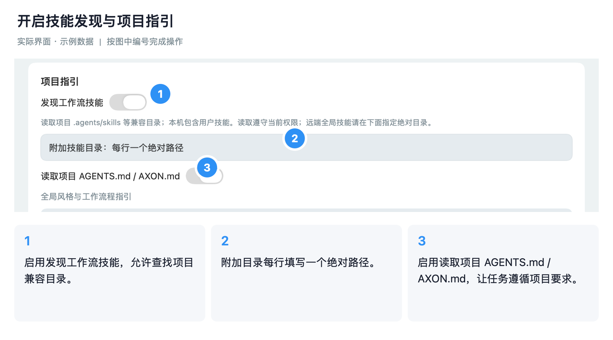

1．启用发现工作流技能，允许查找项目兼容目录。；2．附加目录每行填写一个绝对路径。；3．启用读取项目 AGENTS.md / AXON.md，让任务遵循项目要求。

### 操作步骤

1. 在项目根目录放 AGENTS.md 或 AXON.md，写明构建、测试、目录约定和验收要求；同目录 AXON.md 优先。子目录可添加更具体的指引。
2. 在 AI 设置开启「读取项目 AGENTS.md / AXON.md」；全局风格与工作流程指引填写适用于所有项目的偏好。
3. 开启「发现工作流技能」。项目 .agents/skills 等兼容目录和本机用户技能会参与发现；远端附加技能目录使用服务器上的绝对路径，每行一个。
4. 连接目标后在知识与技能点「发现技能」；或空草稿输入 / 使用选择器。选技能并填写任务参数，检查草稿后发送。
5. 本机技能可在技能管理中创建、编辑、导入导出；助手调用前读取最新 SKILL.md。规则不匹配时说明原因再选择合适流程。

示例：

```text
使用项目中的发布检查技能。先读取最新 SKILL.md 和相关目录指引，完成只读检查并报告，不发布或重启服务。
```

结果检查：执行过程确认使用了正确技能路径和当前项目指引；没有读取权限时先解决配置或改用可用流程。

注意与边界：指引、技能、导入文件都是任务资料，不能覆盖永久禁止规则或批准操作。当前不提供外部技能商店自动安装。

## 14 · 文件差异审查、多文件修改

批准前可选择差异块、手改或集中反馈。

入口：AI 修改审批 → 查看差异并应用。

流程图：提出修改 → 查看差异 → 选择或修订 → 应用验证

### 看图操作

#### 图 1 · 逐块审查文件差异


1．先确认文件路径和原文行范围。；2．勾选要接受的块；替换内容可手工编辑。；3．写行审查意见或统一修订要求，再要求 AI 修订。

#### 图 2 · 只应用已选且审查过的修改

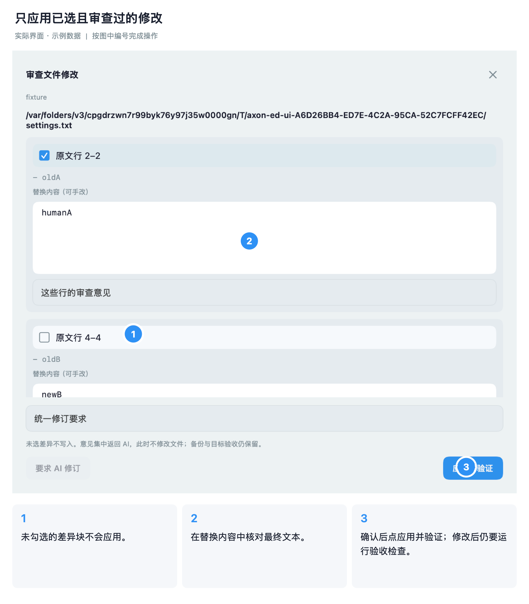

1．未勾选的差异块不会应用。；2．在替换内容中核对最终文本。；3．确认后点应用并验证；修改后仍要运行验收检查。

### 操作步骤

1. 要求助手先读取原文件并提出最小改动。遇到修改审批点「查看差异并应用」，先看路径、原文与新文。
2. 逐个检查文件和差异块，取消不需要的块；需要精调时手动修改草稿，注意保持语法和相关配置一致。
3. 在原文行添加意见，集中要求 AI 修订；新方案生成后重新检查，不能把旧批准当作新方案批准。
4. 确认所选改动后应用。Axon 在提交前重查原内容、权限与策略；发生并发修改时停止覆盖并报告冲突。
5. 应用后运行与目标相关的检查，例如配置校验、单元测试或服务健康检查；阅读实际结果再判断成功。

示例：

```text
把引用配置的超时调整为 30 秒，只改对应项。先展示差异，保留其他内容；应用后执行配置语法校验，并报告结果。
```

结果检查：只有已审查内容被写入；测试或健康检查证据与原目标对应，未确定事项明确列出。

注意与边界：每组最多 8 文件，每文件 64 KiB。组提交失败会尝试恢复，但不保证跨文件瞬时原子可见；Shell 任意写入不享有同等差异和恢复能力。

## 15 · 文件时间线：撤销、重做与冲突

恢复 Axon AI 文件工具记录的旧版本。

入口：助手 → 文件历史。

流程图：选择记录 → 核对文件 → 预览撤销 → 审查应用

### 看图操作

#### 图 1 · 预览撤销与重做，再选择差异块


1．从左侧选一次记录，右侧选择需要恢复的文件。；2．点预览撤销或预览重做，阅读当前文件与目标版本差异。；3．勾选需要的差异块，再点应用已审查的恢复。

#### 图 2 · 遇到人工修改冲突怎么办

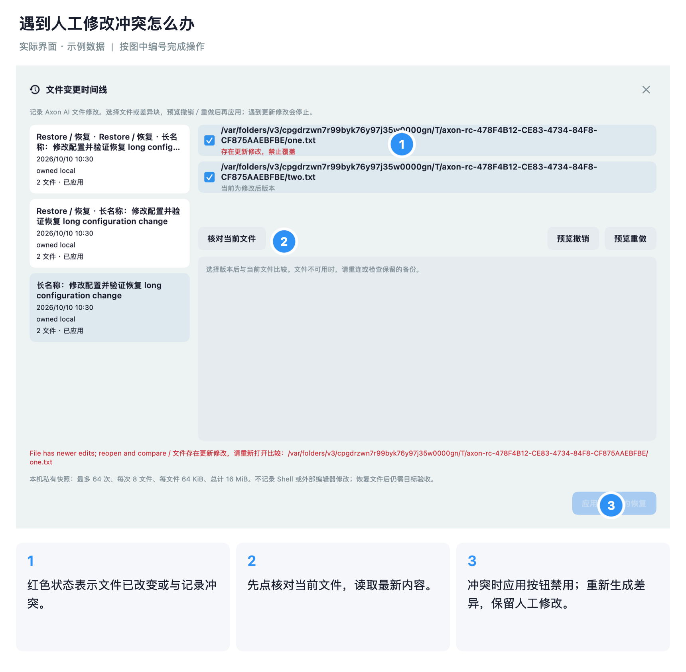

1．红色状态表示文件已改变或与记录冲突。；2．先点核对当前文件，读取最新内容。；3．冲突时应用按钮禁用；重新生成差异，保留人工修改。

### 操作步骤

1. 任务停止且目标已连接时打开「文件历史」，左侧选择一次修改。查看文件列表与版本信息。
2. 点「核对当前文件」，确认当前为修改前、修改后、另一已记录版本，还是存在更新修改。
3. 勾选要恢复的文件，点「预览撤销」恢复修改前内容，或「预览重做」恢复修改后内容。预览中可进一步选择差异块。
4. 仔细检查当前内容与恢复后的差异，点「应用已审查的恢复」。应用前再次检查权限与冲突。
5. 恢复后重新运行必要测试和健康检查，向助手说明恢复结果；存在更新修改时先人工比较，不强制覆盖。

示例：

```text
先停止当前任务。我将从文件历史撤销这次配置修改；恢复后请重新检查配置和服务状态，不重复执行原修改。
```

结果检查：当前文件与所选版本一致，恢复结果可核对；服务是否恢复需要额外验收。

注意与边界：本机私有快照有 64 次修改、8 文件／次、64 KiB／文件、16 MiB 总量上限。只记录 Axon AI 文件修改，不记录外部编辑器或任意 Shell 写入。这与安装旧版应用备份不同。

## 16 · Git 审查、行评论与 worktree

适用于本机项目的版本管理及独立项目任务。

入口：SFTP／本机文件 → 本机目录的操作菜单 → 开发工具… → 本地开发工具。

流程图：打开仓库 → 审查差异 → 集中反馈 → 独立任务

### 看图操作

#### 图 1 · 查看 Git 差异并提交行审查意见


1．选择文件和差异视图，读取对应行的变化。；2．填写差异行号与审查意见，然后点添加。；3．点交给 AI 审查，带入这些行意见创建项目任务。

#### 图 2 · 为独立任务选择工作树


1．视图选择工作树；填写分支与绝对目录后创建。；2．对已有工作树点打开目录进入文件工作区。；3．点独立项目任务，在该目录开始任务；删除仅允许干净的受管理工作树。

### 操作步骤

1. 在本机文件工作区打开仓库目录，从操作菜单选「开发工具…」，在「Git 修改」检查分支、文件状态、工作区差异及暂存差异。
2. 逐文件审查后执行暂存或取消暂存；切换分支要求工作树满足界面条件，避免把未提交改动误带到其他分支。
3. 点击差异行号添加行评论，保存意见；用集中反馈入口把评论、原／新行号与引用文本填入项目任务草稿，检查后发送。
4. 需要隔离修改时在工作树面板创建新分支 worktree，选择绝对目录并打开。为新目录注册独立上下文，使用项目任务执行。
5. 项目任务绑定固定目录，具有独立历史与上下文，不占用当前终端 PTY。完成后检查变更和测试，再安全移除不需要的 worktree。

示例：

```text
请在当前项目任务的固定目录处理审查意见：先读取相关文件和指引，给出最小修复；保留我的未提交修改并完成相关测试。
```

结果检查：差异属于正确仓库、分支和 worktree；反馈只填入草稿；删除工作树前确认没有需要保留的改动。

注意与边界：此功能主要面向本机 Git；不自动提交、推送或创建远端 PR。独立工作树不意味着目标进程拥有操作系统级隔离。

## 17 · 编辑器与语言服务 LSP

用已安装的语言服务查看符号、诊断和格式化草稿。

入口：本机文件工作区 → 打开文件编辑器 → 语言服务配置。

流程图：配置服务 → 打开文件 → 看诊断 → 格式化草稿

### 看图操作

#### 图 1 · 连接语言服务并检查代码

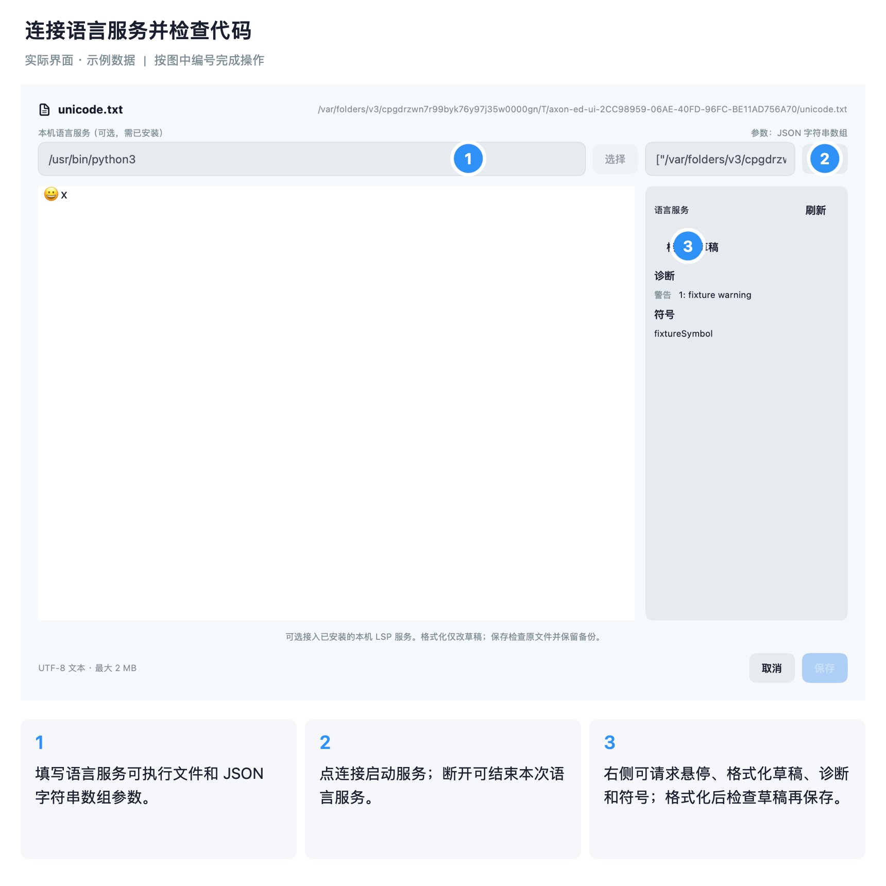

1．填写语言服务可执行文件和 JSON 字符串数组参数。；2．点连接启动服务；断开可结束本次语言服务。；3．右侧可请求悬停、格式化草稿、诊断和符号；格式化后检查草稿再保存。

### 操作步骤

1. 先在本机安装适合语言的 LSP 程序；打开文本编辑器，在「本机语言服务」填写可执行文件绝对路径和 JSON 字符串数组参数，或点「选择」挑选程序，再点「连接」。
2. 打开匹配语言的本机文本文件，连接语言服务。使用符号列表定位定义位置，查看当前文档版本的诊断。
3. 有错误时结合诊断与源码让助手分析；可引用精确行范围，避免只发送诊断标题。
4. 使用格式化更新编辑草稿，审查结果再保存。文档修改后等待当前版本诊断，不把旧诊断当作最新结果。

示例：

```text
请解释引用文件中的诊断，给出最小修复方案。保留现有格式，先展示差异，不执行大范围重构。
```

结果检查：语言服务已连接且诊断对应当前版本；格式化结果在保存前可检查。

注意与边界：Axon 不自带所有语言服务，也不是完整 IDE。符号、诊断和格式化依赖显式配置的已安装服务。

## 18 · 批准模式、命令规则与工具权限

把权限限制设在合适范围，审批时核对真实操作。

入口：AI 设置 → 执行策略／工具权限；主机编辑 → AI 命令权限。

流程图：系统规则 → 主机规则 → 操作审批 → 执行前重检

### 看图操作

#### 图 1 · 设置批准模式与命令规则


1．先选择任务批准模式。；2．设置系统命令规则；主机专用规则在对应主机设置。；3．分别设置工具类别；始终确认、自动允许和禁止各自独立。

#### 图 2 · 工具类别的四种权限怎样选择

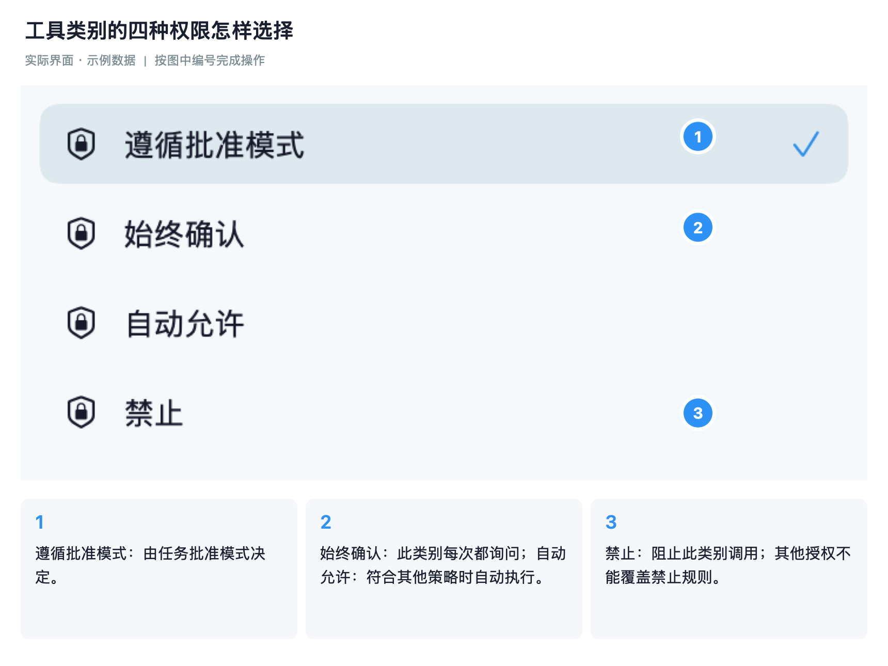

1．遵循批准模式：由任务批准模式决定。；2．始终确认：此类别每次都询问；自动允许：符合其他策略时自动执行。；3．禁止：阻止此类别调用；其他授权不能覆盖禁止规则。

### 操作步骤

1. 初次使用选「每次批准」；「辅助」按规则允许部分操作；「完整权限」减少确认，但不会绕过内置禁止、黑名单或显式 ask。
2. 系统命令允许／禁止名单每行填写一个命令名。服务器规则在主机编辑的「AI 命令权限」配置；两级黑名单优先。命令名规则覆盖参数、sudo 及绝对路径，需谨慎设允许范围。
3. 按类别配置读取与检索文件、应用文件修改、执行命令、运行中终端交互、网页搜索及 MCP 权限。禁止优先于允许；“始终确认”不能被记住的批准绕过。
4. 审批卡片上检查来源、目录、命令或 MCP 参数。默认只允许这次；只有界面提供并确有需要时选择记住允许／禁止，或本任务终端操作范围。
5. 外部脚本先经过静态检查；不支持的动态执行、下载即执行或无法检查的脚本可能拒绝。请改为可审查的直接操作。

示例：

```text
只允许读取和检查；不要删除文件、写入配置或重启服务。任何需要修改的步骤先给我方案和差异。
```

结果检查：批准的是当前明确操作，策略与目标相符；拒绝后没有继续执行旧动作。

注意与边界：自然语言“允许”不能覆盖系统策略。模型运行限制不等于服务器 OS 沙箱；目标操作仍使用本机／SSH 当前账号权限。脱敏是有界保护，不保证识别所有秘密。

## 19 · Agent 预设与运行限额

保存不同任务常用的模型、权限与指引配置。

入口：AI 设置 → Agent 预设；执行策略。

流程图：调整配置 → 保存预设 → 选择预设 → 下一任务生效

### 看图操作

#### 图 1 · 保存和切换 AI 设置预设

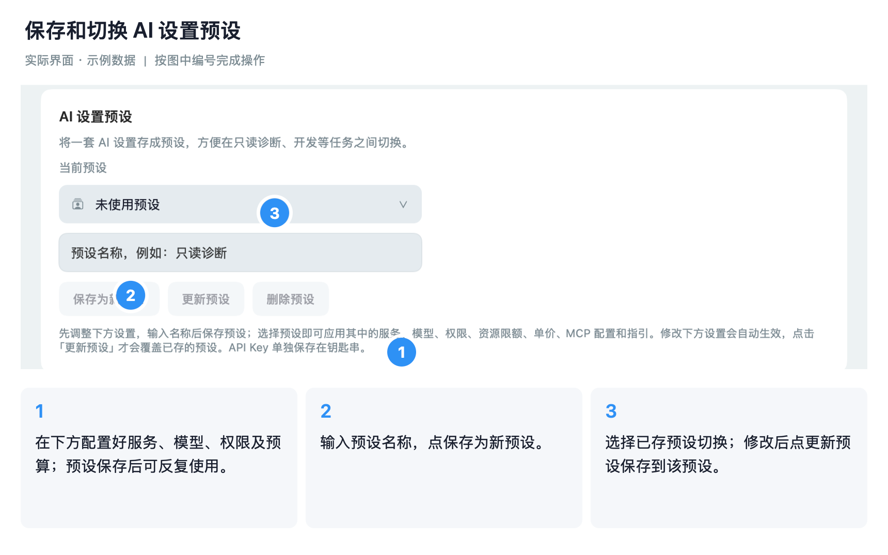

1．在下方配置好服务、模型、权限及预算；预设保存后可反复使用。；2．输入预设名称，点保存为新预设。；3．选择已存预设切换；修改后点更新预设保存到该预设。

#### 图 2 · 设置工具权限与任务运行限额

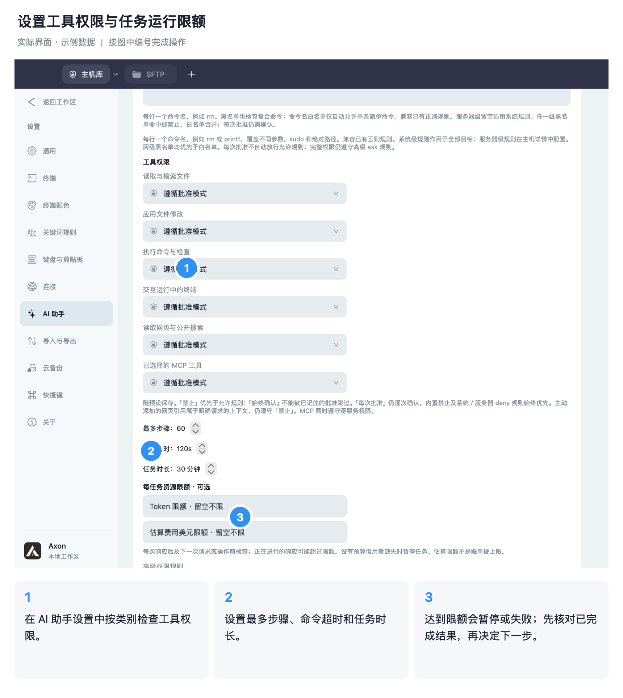

1．在 AI 助手设置中按类别检查工具权限。；2．设置最多步骤、命令超时和任务时长。；3．达到限额会暂停或失败；先核对已完成结果，再决定下一步。

### 操作步骤

1. 先设置服务、模型、Agent 执行方式、项目指引、工具权限和任务预算。
2. 在 Agent 预设填写名称并保存；已有预设可选择、更新或删除。切换后核对当前字段和自动保存反馈。
3. 按任务需要调整最多步骤、命令超时和任务时长。达到上限会停止继续动作，不代表任务完成。
4. 为只读排查与开发修改保存不同预设。发送前检查目标与预算，不依赖名称猜测实际权限。

示例：

```text
按当前只读排查预设定位错误，若达到限额先总结已检查证据与剩余事项，不继续修改。
```

结果检查：所选预设实际字段符合预期；任务限额适合本次操作。

注意与边界：API Key 不进入预设，仍保存在钥匙串。提高限额不能解决未核对的命令、文件冲突或禁止规则。

## 20 · Token、费用估算与预算

观察本次会话用量，设置继续执行的资源门槛。

入口：助手 → 用量；AI 设置 → 用量与费用估算／每任务资源限额。

流程图：填写单价 → 设置预算 → 执行任务 → 查看用量

### 看图操作

#### 图 1 · 查看 Token 与已知费用


1．顶部看请求次数、输入输出和缓存 Token 汇总。；2．逐请求查看服务、模型和费用是否有报告。；3．未完整提供费用的请求会标为未知，不能当作零。

#### 图 2 · 填写单价并设置任务预算

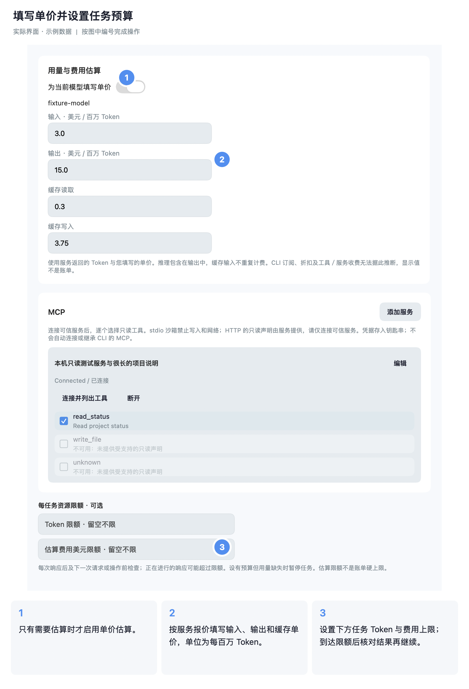

1．只有需要估算时才启用单价估算。；2．按服务报价填写输入、输出和缓存单价，单位为每百万 Token。；3．设置下方任务 Token 与费用上限；到达限额后核对结果再继续。

### 操作步骤

1. 在设置为当前明确模型启用单价，填写输入、输出、缓存读取及缓存写入的美元／百万 Token 价格。价格由你按服务提供方信息填写。
2. 在每任务资源限额填写 Token 或估算美元上限；留空不限。运行前检查预设是否带入旧预算。
3. 打开「用量」查看已知输入／输出 Token、缓存、推理、请求次数及已定价估算。展开请求看各次响应状态和模型。
4. 看到未完整提供用量、未定价或旧历史未知时，不能按零计算。配置预算但证据不足时任务会暂停。
5. 限额触发后先查看已完成操作及剩余事项；需要继续时调整预算并核对原目标，再继续任务。

示例：

```text
在预算范围内先完成只读定位。如果用量未知或达到上限，停止继续操作并列出已完成检查和剩余事项。
```

结果检查：已知小计与未知请求分别显示；费用对应当前模型价格，历史恢复不会变成零用量。

注意与边界：每次响应后及下一次请求／操作前检查，进行中的响应可能超额。推理包含在输出中，缓存不重复计费；估算不是账单或硬支付上限，不含外部工具收费。 同一请求的重复或延迟用量报告不会降低已计入的 Token 和预算。

## 21 · MCP：连接、选工具与调用

仅开放你明确选择的受支持只读工具。

入口：AI 设置 → MCP → 添加服务。

流程图：添加服务 → 手动连接 → 勾选只读工具 → 审批调用

### 看图操作

#### 图 1 · 新增 MCP 服务并保存配置

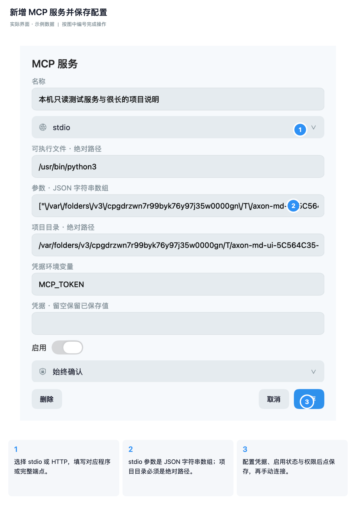

1．选择 stdio 或 HTTP，填写对应程序或完整端点。；2．stdio 参数是 JSON 字符串数组；项目目录必须是绝对路径。；3．配置凭据、启用状态与权限后点保存，再手动连接。

#### 图 2 · 连接后只选择需要的工具

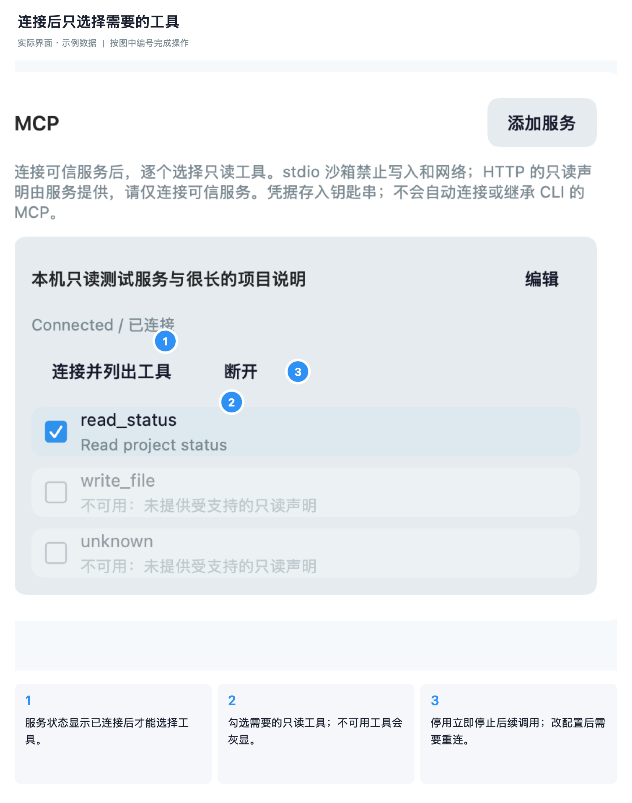

1．服务状态显示已连接后才能选择工具。；2．勾选需要的只读工具；不可用工具会灰显。；3．停用立即停止后续调用；改配置后需要重连。

#### 图 3 · 实际调用前核对审批内容


1．核对服务、工具、目标与完整参数。；2．本次允许范围由审批面板显示；MCP 不跨请求记住批准。；3．确认后点允许并继续；不符合目标就取消任务。

### 操作步骤

1. 点「添加服务」，填写名称并选择 stdio 或 Streamable HTTP。最多 8 个服务。
2. stdio：填写可信程序绝对路径、项目目录及 JSON 字符串数组参数，例如 ["/absolute/path/server.py"]。参数按字面传入，不当 Shell 命令执行；需要凭据时指定环境变量名并填写安全凭据。
3. HTTP：填写服务提供方给出的完整 MCP 接口地址及凭据。只连接你信任的服务，确认其工具只读声明。
4. 选择启用和逐服务权限，保存后点「连接并列出工具」。勾选需要的只读工具；没有受支持只读声明的工具不可用。
5. 回到任务明确要求查询所选工具，审批时检查 MCP 来源、工具名和参数。配置改变后重新连接；不需要时断开或禁用。

示例：

```text
使用我已连接并勾选的 MCP 只读状态工具查询服务状态；先说明来源和参数，不调用未选工具或写入工具。
```

结果检查：服务显示已连接，工具已勾选，执行记录有正确的 MCP 来源与返回内容。

注意与边界：stdio 沙箱禁止写入和网络，一些依赖网络／写缓存的服务器不兼容。HTTP 只读是服务方声明，不是远端安全证明。凭据存钥匙串；不会自动连接，也不继承 CLI MCP。 工具目录过长时保留完整工具定义并提示省略数量；需要使用未展示的工具时，在设置中减少工具选择后再尝试。

## 22 · 停止、失败恢复与完成验收

以实际回执和目标检查判断进度，避免重复副作用。

入口：停止 AI；检查进度并继续；恢复证据；文件历史。

流程图：停止或失败 → 检查回执 → 核对目标 → 继续验收

### 看图操作

#### 图 1 · 从回执核对失败与完成状态


1．按原目标查看对应任务记录。；2．阅读工具与执行回执，区分完成、失败和未知。；3．检查目标验收记录；历史通过不等于继续任务后仍有效。

### 操作步骤

1. 失败时先阅读错误与最后几步工具结果，区分模型请求失败、命令失败、断连、预算限制和文件冲突。不要立即重复整条修改命令。
2. 点「恢复证据」查看执行回执、结果是否完成、是否不确定，以及目标验收待办。命令退出码与实际输出要一起检查。
3. 需要继续时恢复原目标连接，点「核对进度并继续」或从历史打开会话。助手重新检查目标并保留已完成结果。
4. 文件修改不确定时先在文件历史核对与预览恢复；Shell 副作用需人工检查。结果不明的命令不会自动重放。
5. 最后逐项检查原目标：配置是否有效、服务是否健康、测试是否通过。保存的历史通过结果只是当时证据，继续任务仍需重检。

示例：

```text
请先核对原目标和已完成回执，不重复已提交操作。列出确定完成、结果不明和未完成事项，再按原验收条件继续检查。
```

结果检查：结论包含实际验证结果和剩余阻碍；没有凭计划勾选、模型结束或单一退出码声称目标成功。

注意与边界：取消请求不撤销已经执行的副作用。未知修改会阻止新的修改和成功结论；任意 Shell 操作没有通用自动回滚。

## 23 · 三个完整实战流程

按场景选择最小工作流，再逐步使用高级能力。

入口：终端助手／项目任务 → 引用 → 计划 → 审批 → 验收。

流程图：收集证据 → 限定方案 → 审查修改 → 验证结论

### 看图操作

#### 图 1 · 实战：从配置修复走到验收

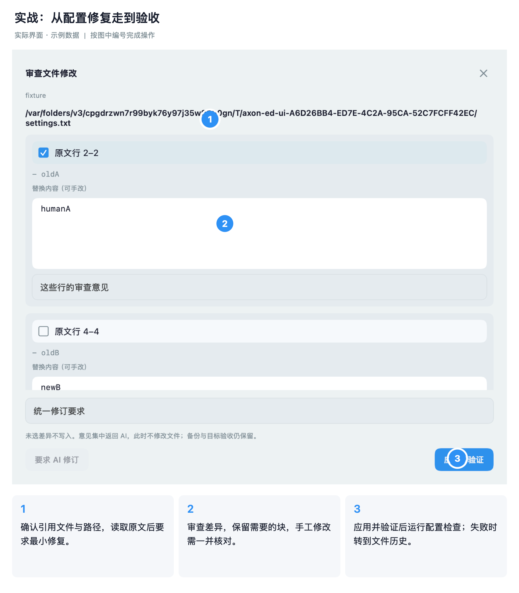

1．确认引用文件与路径，读取原文后要求最小修复。；2．审查差异，保留需要的块，手工修改需一并核对。；3．应用并验证后运行配置检查；失败时转到文件历史。

#### 图 2 · 实战：在独立项目任务里开发

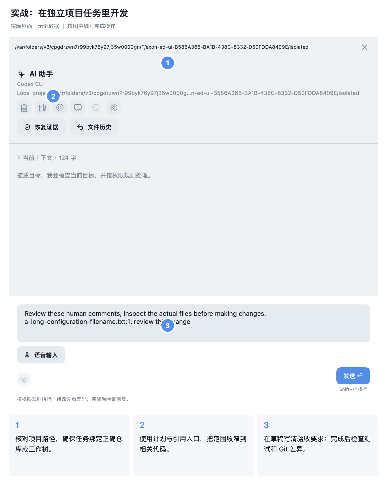

1．核对项目路径，确保任务绑定正确仓库或工作树。；2．使用计划与引用入口，把范围收窄到相关代码。；3．在草稿写清验收要求；完成后检查测试和 Git 差异。

### 操作步骤

1. 日志排障：连接目标 → 选择对话助手 → 引用日志行 → 要求定位 → 切当前终端只读检查 → 看回执 → 必要时提出修改方案。
2. 配置修复：确认绝对路径 → 引用原文件 → 要求最小修改及验收 → 审查差异 → 应用 → 执行配置校验和服务检查 → 失败则查看文件历史。
3. 本机代码任务：打开仓库 Git → 检查未提交改动 → 按需建 worktree → 打开项目任务 → 注册项目和引用代码 → 选计划阶段 → 审查修改 → 运行相关测试 → 查看 Git 差异。
4. 复杂任务可保存工作流模板、使用技能和任务预算；结果确定前不要仅靠计划状态进入下一阶段。

示例：

```text
请修复引用文件中的问题。先读项目指引和相关代码，保留其他未提交改动，提出最小方案与验收步骤；修改先让我看差异，完成后列出测试结果。
```

结果检查：范围明确、已有修改保留、变更可审查、结果有可复核证据。

注意与边界：生产服务的重启、删除或发布应在任务中明确授权。示例不会自动批准相关操作。

## 24 · 常见问题与速查

按现象找到下一步，不盲目重复执行。

入口：本手册搜索；设置反馈；执行过程；恢复证据。

流程图：识别现象 → 看真实状态 → 修正条件 → 核对后继续

### 看图操作

#### 图 1 · 遇到问题先用手册目录和搜索定位

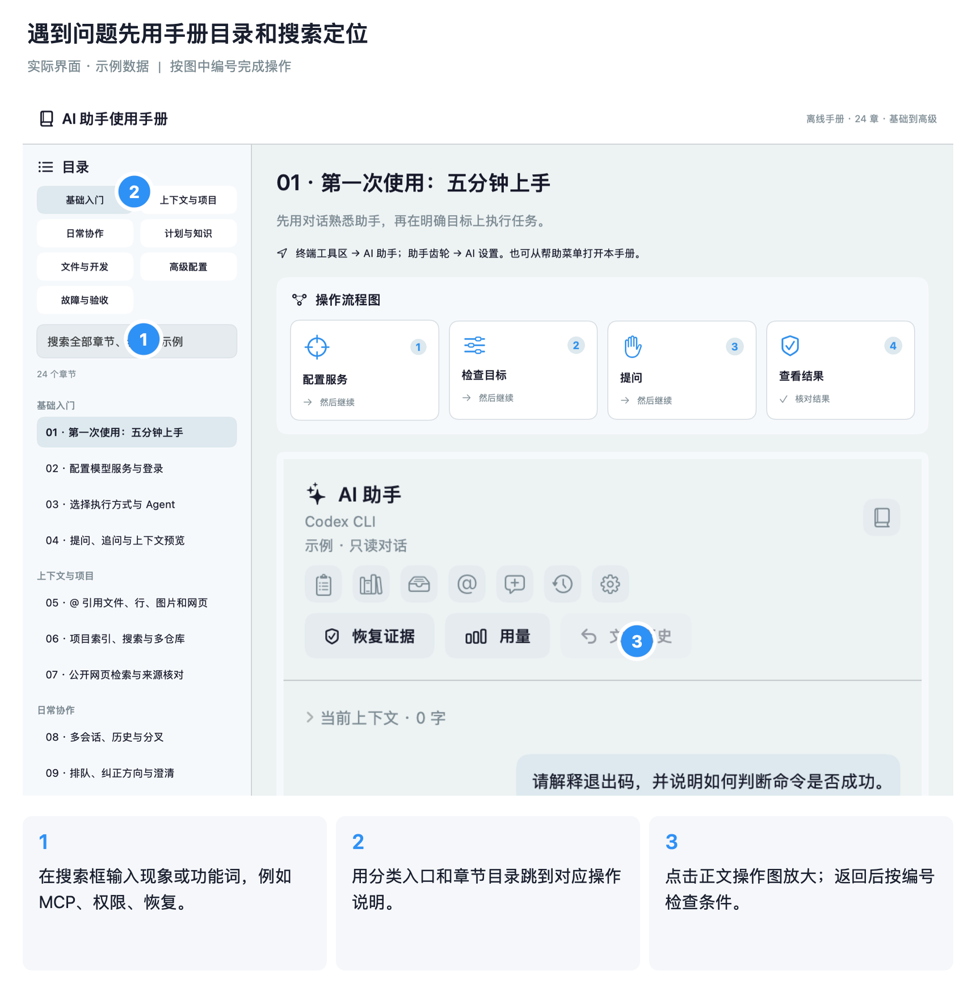

1．在搜索框输入现象或功能词，例如 MCP、权限、恢复。；2．用分类入口和章节目录跳到对应操作说明。；3．点击正文操作图放大；返回后按编号检查条件。

### 操作步骤

1. 发送按钮不可用：检查草稿是否为空、目标是否连接、当前是否待审批／澄清；纯分析可以选择对话助手。
2. 未找到 Codex：检查程序绝对路径与本机 CLI 登录，必要时填写 Node.js 包装器回退路径，刷新模型。API 认证失败则检查服务、完整地址、模型和钥匙串密钥。
3. 工具被拒绝：检查系统与服务器 deny、工具类别、逐 MCP 服务权限及内置禁止规则。人工回答澄清不能代替批准。
4. 找不到文件或搜索结果少：核对本机／SSH 路径、索引目标、忽略规则、权限和容量状态；同步或重建，再显式引用精确文件。
5. 命令结果不明或任务卡住：检查原终端与运行程序列表；先看回执，不重复副作用。停止 AI 与中断程序分别操作。
6. 差异应用失败：可能原文件已变或权限改变。读取当前文件，保留人工修改，要求重新生成差异；恢复冲突不能强制覆盖。
7. MCP 不可用：保存后需手动连接、勾选只读工具；改配置需重连。stdio 不支持写入／网络需求，HTTP 检查完整端点和服务凭据。
8. 用量未知：服务未完整报告或历史版本没有记录；不能视为零。预算暂停时核对用量与已完成工作再决定下一步。
9. 听写或通知不可用：检查 macOS 系统授权和语言资源；通知在会话与收件箱查看，系统横幅受系统设置影响。

示例：

```text
请根据最后一条错误和恢复回执，说明阻碍、已完成事项及需要我检查的条件，不重复执行结果不明的命令。
```

结果检查：下一步针对明确条件，任务继续前重新核对目标。Return 发送、Shift+Return 换行；手册 ⌘F 聚焦搜索，⌘W 关闭独立手册窗口。

注意与边界：能力边界：无云端多用户共同编辑、无自动模型路由、无完整 IDE／任意目标 OS 沙箱、无保证跨退出的排队和终端监控。功能可用性取决于模型、CLI、系统授权、连接与策略。
